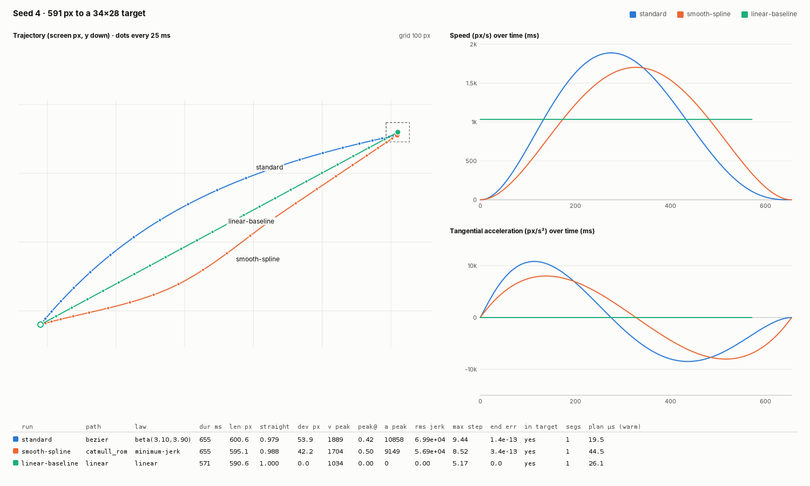

# $bbnors

A modular interaction-simulation and automation framework in Java 21: movement mathematics,
timing and scheduling, mouse/keyboard/camera input, interaction state management, a
DreamBot-inspired scripting API, and a first-class visualization and benchmarking lab.

**This is a learning experiment.** The project is being adapted to work with the official OSRS
client, not just the built-in simulator. The goal is to learn how game automation frameworks
interface with real clients — how `GameClient` adapters are built, how input delivery works
against a live window, and how the framework's abstractions hold up outside a controlled
simulation.

The core is backend-agnostic. Game state comes in through one interface, `GameClient`, with a
complete simulated backend for tests and development, and an in-progress adapter for the
official client. The project does **not** include detection-evasion functionality; see
[docs/ARCHITECTURE.md §2](docs/ARCHITECTURE.md).



## Modules

| Module | Purpose | Game-independent |
|---|---|---|
| `bbnors-core` | clock, RNG, event bus, typed config, logging | ✅ |
| `bbnors-motion` | Bezier / Catmull-Rom / wind paths, arc length, timing laws, Fitts, planner, profiles | ✅ |
| `bbnors-engine` | interaction manager, mouse, keyboard, camera, timing profiles, waits, schedulers | ✅ |
| `bbnors-api` | `GameClient` SPI, queries, managers, pathfinding, script runtime, simulator | uses `GameClient` |
| `bbnors-lab` | Swing visualizer, headless export, benchmark suite | ✅ (plus a simulator benchmark) |
| `bbnors-runelite` | RuneLite plugin: official client `GameClient` adapter | uses RuneLite API |
| `bbnors-examples` | example scripts against the simulator | — |

## Quick start

```bash
./gradlew build                                   # compile + 80 tests
./gradlew :bbnors-lab:run                         # interactive movement lab
./gradlew :bbnors-examples:run --args="list"              # registered scripts
./gradlew :bbnors-examples:run --args="woodcutter 300 7"
./gradlew :bbnors-lab:bench                       # benchmarks → bench-results/
./gradlew :bbnors-lab:run --args="evaluate --profiles standard,precise,fast --trials 600"   # batch profile evaluation
```

## A script

```java
public final class Woodcutter extends TaskScript {
    public Woodcutter() {
        add(new Task() {                       // bank when full
            public String name() { return "bank"; }
            public int priority() { return 10; }
            public boolean accept(ScriptContext c) { return c.inventory().isFull(); }
            public int execute(ScriptContext c) {
                if (!c.bank().open()) return 1200;
                c.bank().depositAll("Logs");
                c.bank().close();
                return 300;
            }
        }, new Task() {                        // otherwise chop
            public String name() { return "chop"; }
            public boolean accept(ScriptContext c) { return c.player().idle(); }
            public int execute(ScriptContext c) {
                c.objects().name("Tree").action("Chop down").nearest().ifPresent(t -> {
                    if (c.interact(t, "Chop down")) {
                        c.waitUntil(() -> c.player().animation() != -1)
                         .timeout(Duration.ofSeconds(4)).resetWhile(() -> c.player().moving()).await();
                    }
                });
                return 600;
            }
        });
    }
}
```

Run it deterministically: `Simulation.create(42).runner(new Woodcutter()).runInline(500)`.

## Using the movement engine on its own

```java
MovementProfile p = new MovementProfiles().get("precise");
Motion m = new MotionPlanner().plan(p, new Vec2(80, 400), Rect.centered(new Vec2(600, 120), 30, 30), new Rng(7));
TrajectorySamples s = MotionSampler.sample(m, 200);
System.out.println(MotionMetrics.of(s, m.end(), null));   // duration, peak speed, jerk, ...
```

## Documentation

| | |
|---|---|
| [OSRS_DIRECTION](docs/OSRS_DIRECTION.md) | **proposal:** OSRS product direction, honest assessment, gap analysis, phased roadmap |
| [DEVELOPER_GUIDE](docs/DEVELOPER_GUIDE.md) | **start here**: rules, writing scripts, backends, extending movement/engine, adding modules |
| [SCRIPTING](docs/SCRIPTING.md) | ScriptContext, TaskScript, TreeScript, runner lifecycle, registration |
| [ARCHITECTURE](docs/ARCHITECTURE.md) | modules, scope boundary, decisions (ADRs), threading |
| [MODULES](docs/MODULES.md) / [API_INVENTORY](docs/API_INVENTORY.md) | curated module map / generated public API |
| [STATUS](docs/STATUS.md) | production-ready vs beta vs experimental |
| [SIMULATOR](docs/SIMULATOR.md) | simulated server architecture and limitations |
| [MOVEMENT_DEFAULTS](docs/MOVEMENT_DEFAULTS.md) | every default: derived, measured, engineering choice or assumption |
| [GAME_CLIENT](docs/GAME_CLIENT.md) | the adapter interface |
| [MOVEMENT_ENGINE](docs/MOVEMENT_ENGINE.md) | paths, arc length, timing laws, planning, playback |
| [TIMING_ENGINE](docs/TIMING_ENGINE.md) | timing profiles, waits, schedulers |
| [MOVEMENT_VISUALIZATION](docs/MOVEMENT_VISUALIZATION.md) | the lab: comparison, replay, batch evaluation |
| [PERFORMANCE](docs/PERFORMANCE.md) | benchmarks and the decisions they drove |
| [TESTING](docs/TESTING.md) | test inventory and scenarios |
| [RESEARCH](docs/RESEARCH.md) / [API_COMPARISON](docs/API_COMPARISON.md) | DreamBot / RSBot-lineage review |
| [CONFIGURATION](docs/CONFIGURATION.md) | every setting (generated) |
| [IMPLEMENTATION_LOG](docs/IMPLEMENTATION_LOG.md) / [COMMIT_HISTORY](docs/COMMIT_HISTORY.md) / [ROADMAP](docs/ROADMAP.md) | history, commits with files, prioritized next steps |
