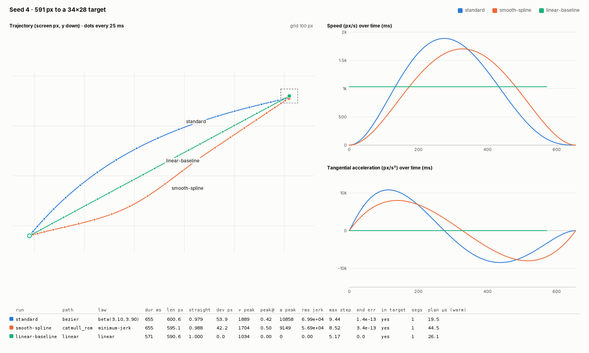
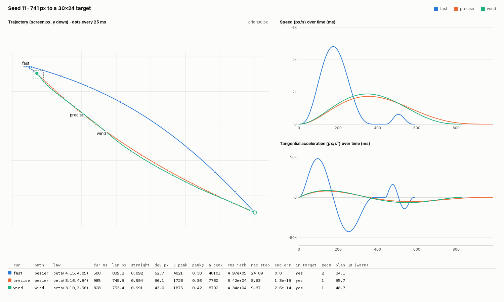

# Movement visualization and analysis

Module: `bbnors-lab`. The lab is standalone and runs without any game client or backend.

## Running

```bash
./gradlew :bbnors-lab:run                          # interactive Swing lab
./gradlew :bbnors-lab:installDist
L=bbnors-lab/build/install/bbnors-lab/bin/bbnors-lab
$L render  --profiles standard,smooth-spline,linear-baseline --seed 4 --out lab-output
$L render  --profiles fast,precise,wind --seed 11 --from 700,450 --target 60,40,30,24
$L compare --profiles standard,precise --seed 7    # metrics only, to stdout
$L bench                                           # benchmark suite (PERFORMANCE.md)
$L config-docs                                     # regenerate CONFIGURATION.md
```

## What is shown





| Panel | Shows |
|---|---|
| Trajectory | path in screen pixels (y down), start ring, end dot, target rectangle (dashed), a dot every 25 ms (close dots = slow, sparse dots = fast), rings at sub-movement boundaries (overshoot corrections), direct run labels |
| Speed over time | analytic speed per run; peak position and shape of the velocity profile |
| Tangential acceleration over time | signed; zero line emphasised; reveals jumps (trapezoid, smoothstep ends) vs smooth laws |
| Metrics table | path, law, duration, path length, straightness, max deviation, peak speed and its normalised time, peak acceleration, RMS jerk, max per-sample step (continuity), endpoint error, in-target, sub-movement count, warm planning cost |

Up to three runs are compared side by side. Colours (blue, orange, aqua) were checked with the
palette validator for all-pairs colour-vision-deficiency separation. The aqua slot falls below
3:1 contrast on the light surface, so every run is also direct-labelled and listed in the table;
identity never depends on colour alone.

## Interactive controls (Swing)

- Choose up to three profiles (A, B, C). Run A's parameters can be tuned live: path family, law,
  curvature, peak, sharpness, Fitts slope, endpoint spread, overshoot.
- Left-drag on the trajectory panel to move the start point; right-click to move the target.
- Hover the time charts to inspect exact values at a time for every run.
- **Replay** animates the cursor along all runs in real time, with a time cursor on the charts.
- **New seed** regenerates. **Export** writes the artefacts below.

## Exports

| File | Content |
|---|---|
| `<name>.png` | the rendered comparison (identical to the on-screen view) |
| `<name>-<run>.csv` | per-sample `t, x, y, vx, vy, speed, acc_tan, acc_norm, acc, segment` |
| `<name>.json` | per run: profile, seed, start, target, motion description, warm planning µs, metrics |
| `<name>.profiles.properties` | the exact profiles used; load them back with `MovementProfiles.load` |

Every run is reproducible from (profile, start, target, seed).

## Integration in the workflow

- The renderer and metrics are covered by tests (`LabTest`), and the benchmark suite runs in CI-able
  form (`LabTest.harnessMeasuresAndSuiteRunsQuickly`).
- Exported profiles feed straight back into `engine.profiles-file`.
- `MotionMetrics` is the same class the movement tests assert on, so what the lab reports is what
  the tests check.
